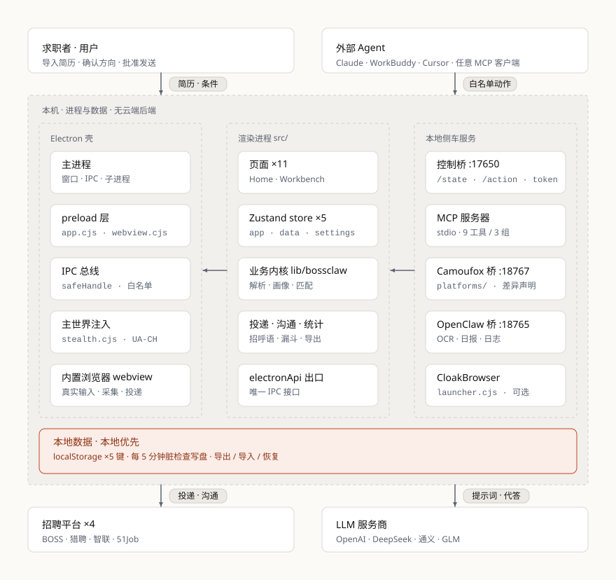

<div align="center">

# BossClaw

**面向求职者的本地 AI 投递助手（Electron 桌面应用）**

独立运行，不占用你的浏览器 —— 简历整理、岗位筛选、匹配排序、沟通草稿和投递进度集中在同一个窗口里。

[这是什么](#这是什么) · [快速开始](#快速开始) · [使用流程](#使用流程) · [核心能力](#核心能力) · [能力规模](#当前能力规模) · [适合谁](#适合谁与不适合谁) · [架构](#架构与布局) · [安全边界](#安全与使用边界) · [Agent 接入](#外部-agent-接入可选控制桥--mcp--代答) · [桌面版说明](desktop-app/README.md) · [Wiki](https://github.com/YanQuan-dozzy/Boss-Claw/wiki)


<h3 align="center">⭐ 如果 BossClaw 对你有帮助，欢迎 <a href="https://github.com/YanQuan-dozzy/Boss-Claw">点个 Star</a> 支持作者，让更多需要的求职者看到它。</h3>

</div>

> 本文以 `main` 分支当前实现为准，**当前版本 v2.6.3**（2026-11-13 发布，Windows / Linux / macOS 均由 CI 统一构建）。

## 这是什么

求职要反复看 JD、判断匹配、整理话术、记录进度、处理失败任务 —— 而岗位散在四个平台、硬门槛和软信号混在一起看、投完就忘、通用 AI 还会替你编经历。BossClaw 把这些环节收成一条本地流程：

```text
导入简历 → AI 职业画像 → 选择投递方向 → 采集岗位 → AI 匹配与排序 → 人工确认 → 投递与跟进
```

系统始终以**求职者身份**工作：画像、判断与沟通内容必须基于真实简历与岗位页面上的信息，不虚构经历、技能、学历、薪资或到岗时间；AI 输出只是辅助建议，**不替用户作求职决定**。

**为什么是桌面端**：投递、沟通与登录态都在应用自带的浏览器窗口里完成，你的 Chrome / Edge / Firefox 照常使用，切走页面或关掉标签都不影响后台投递；简历、画像、任务与 API Key 全部留在本机。

## 快速开始

### 1. 下载安装

产物发布在 [GitHub Releases](https://github.com/YanQuan-dozzy/Boss-Claw/releases/latest)，v2.6.3 由 CI 统一构建 Windows / Linux / macOS 安装包：

| 系统 | 文件 | 说明 |
| --- | --- | --- |
| 🪟 **Windows 10/11（x64）** | [安装版 BossClaw-2.6.3-x64.exe](https://github.com/YanQuan-dozzy/Boss-Claw/releases/latest/download/BossClaw-2.6.3-x64.exe) | 推荐：NSIS 安装包，可自定义目录、创建快捷方式 |
| 🪟 **Windows 10/11（x64）** | [便携版 BossClaw-2.6.3-portable.exe](https://github.com/YanQuan-dozzy/Boss-Claw/releases/latest/download/BossClaw-2.6.3-portable.exe) | 绿色单文件，解压即用 |
| 🐧 **Linux（x86_64）** | [AppImage（v2.6.3）](https://github.com/YanQuan-dozzy/Boss-Claw/releases/latest/download/BossClaw-2.6.3-x86_64.AppImage) | `chmod +x` 后直接运行 |
| 🐧 **Linux（amd64，deb 系）** | [deb（v2.6.3）](https://github.com/YanQuan-dozzy/Boss-Claw/releases/latest/download/BossClaw-2.6.3-amd64.deb) | `sudo dpkg -i`，缺依赖补 `sudo apt -f install` |
| 🍎 **macOS（Apple Silicon）** | [dmg（arm64，v2.6.3）](https://github.com/YanQuan-dozzy/Boss-Claw/releases/latest/download/BossClaw-2.6.3-arm64.dmg) | 未签名：首次打开需右键「打开」，或执行 `xattr -dr com.apple.quarantine` |
| 🍎 **macOS（Intel）** | [dmg（x64，v2.6.3）](https://github.com/YanQuan-dozzy/Boss-Claw/releases/latest/download/BossClaw-2.6.3-x64.dmg) | 未签名：首次打开需右键「打开」，或执行 `xattr -dr com.apple.quarantine` |
| 🍎 **macOS 源码档案** | [mac.tar.gz（v2.6.3）](https://github.com/YanQuan-dozzy/Boss-Claw/releases/latest/download/BossClaw-2.6.3-mac.tar.gz) | 需要自行构建时使用，解压后执行 `./build-mac.sh` |

> 所有产物均由同一 tag 的 CI 构建：Windows / Linux 直接可用；macOS 提供 arm64 / x64 dmg（未签名、未公证，首次打开需右键「打开」或移除 quarantine 属性），另附源码档案供自行构建。运行要求：Windows 10/11（x64）、主流 x86_64 Linux，或 macOS 10.15+；要 rpm / pacman 等其它格式，向 `build.linux.target` 补目标后重新打包。

### 2. 首次配置

1. 「设置」填求职条件与 AI API Key（预设 OpenAI / DeepSeek / 通义千问 / 智谱 GLM / 硅基流动 / 火山方舟，或自定义 OpenAI 兼容端点）→ 测试连接
2. 「简历中心」导入简历并核对原文 → 生成职业画像（**删掉任何不准确、无证据或夸大的内容**）
3. 「投递方向」勾选方向并点「确认方向」（未确认不会建立任务）
4. 「工作台」打开岗位 → 「加入任务」→ 中栏核对后批准 → 人工确认发送

> API Key 只存本机。未配置时可改用 [外部 Agent 代答](#外部-agent-接入可选控制桥--mcp--代答)，或按 [本地开发](#本地开发) 自行构建。

### 3. 首次执行只做一条验收

第一次用半自动 / 自动辅助时**只处理一个自己确认的岗位**，逐项核对：打开的是所选岗位、沟通对象一致、文字基于真实简历、页面出现完整的**已发送文字气泡**、状态记录正确、无登录异常或安全验证。任何一步确认不了就暂停查原因，不要连续重试 —— 系统在首次成功投递后也会**强制暂停**待你验收。

## 使用流程

| 节奏 | 发送方式 | 适合 |
| --- | --- | --- |
| **人工确认** | AI 出分析与草稿，用户逐条检查、修改后决定是否继续 | 首次使用、对草稿不放心 |
| **半自动投递** | 中栏批准 → 跳转岗位页 → 草稿预填 → **用户点发送** | 日常主力 |
| **自动辅助** | 按优先级依次投递 `approved_queue`，失败自动暂停交人工 | 岗位量大、已建立信任 |
| **自动沟通** | 真实浏览器引擎按优先级打开沟通窗口并发送，确认后计成功 | 批量触达 |

自动沟通下 BOSS 可另开「AI 跟聊监听」（冷却期或未登录时不可开启）。

- **多平台投递**：「一键投递」按岗位平台分派 —— BOSS 走内置浏览器详情页真实 DOM（启用「优先隐身通道」时改走 Camoufox），其余三平台在各自标签页内投递；外部网申 / 已投递岗位自动跳过。
- **多平台采集**：按是否启用隐身引擎分派 —— Camoufox（列表 + 详情 JD + 词级断点续采）或内置浏览器可视化采集（BOSS 详情级、其余列表级，详情 JD 按平台同源接口补齐，**未装 Camoufox 也能采非 BOSS 平台**）。各平台按优先级串行，遇队列级阻断整批中止交人工；「基础求职条件」（求职类型 / 经验 / 学历 / 公司规模）在两条通道、四个平台一致生效。

进度与异常任务在「任务进度」页查看（阶段标签 + 实时日志），失败任务可打开原岗位后单条重试、忽略或继续。

## 核心能力

### 1. 工作台与多平台

三栏布局（侧栏 + 消息进度 + 内置浏览器），承载「搜索采集 → 审核 → 投递」闭环。BOSS 直聘为默认平台，**猎聘 / 智联 / 前程无忧 51Job** 可启用；平台优先级与每日配额可调，登录态按平台独立持久化。四平台均已打通「搜索 → 列表采集 → 详情 JD → 审核入队 → 投递」全链路。

> **一次采集能翻多少页**：内置浏览器通道不分页 —— BOSS 是无限加载（「自动下拉最大轮数」默认 12 轮），其余三平台真分页但**只采第 1 页**；Camoufox 通道按「搜索结果页数」逐页翻（默认 1、上限 10，服务端可调至 20），24 小时内同一「平台 × 城市 × 关键词」重采不会被断点跳过。

### 2. 简历 · 画像 · 定制简历

简历导入 PDF / DOCX / DOC / MD / TXT，**全部本地解析**并保留可编辑原文。AI 生成可编辑职业画像（失败逐级回落本地规则），投递方向支持勾选、改搜索词、调优先级与 AI 校准关键词；输入目标 JD 还能生成**定制简历**（摘要 / 量化经历 / 求职信 / 技能缺口 / 优化建议），仅引用真实事实，不达标回退本地规则。

### 3. 确定性过滤（不花 Token）

城市反选、公司 / 猎头黑名单、HR 活跃度、面试方式（**未明确披露不误杀**）、JD 截止日期过期判定（仅 JD 显式写明时生效，默认猎聘开启）。这些判定纯本地执行，不消耗 AI Token，也不占投递配额。

### 4. AI 匹配与评分

**四层整体裁决**：硬门槛 → 优先条件 → 职责信号 → 团队信号，一次给出 `fitLevel` 档位（`strong` / `match` / `cautious` / `unfit`）。分数随档走、**AI 分即最终分**，不做跨档加权；本地五维分只用于展示与兜底，唯一能改分的机制是硬约束拦截。

### 5. 沟通 · 投递与自动沟通

AI 生成求职者口吻的个性化招呼语（**≤250 字**），「一键投递」按岗位平台自动分派通道。Camoufox 批量沟通按平台优先级串行、各平台独立计数：BOSS 发招呼语并以**文字气泡确认**为成功依据；猎聘走「聊一聊」+ App 预设招呼语；智联 / 前程无忧投递简历。

**AI 跟聊（仅 BOSS，可选）**：常驻巡检「已投递」会话，HR 来新消息即带多轮上下文生成并发送回复，明确拒绝则收口该会话；回复类发送**不计入**单日投递上限。

### 6. 模拟面试

用正在投的岗位 JD + 自己的简历练一场会当场被追问的面试。

> **状态**：v2.6.3 安装包**已包含**（Phase 1–4B），但**尚未经过完整测试**，属「可自行试用」，不保证稳定；部分优化与更新代码**暂不开源**，公开仓库与包内实现可能不完全一致。问题请附版本号与出错步骤提 [Issue](https://github.com/YanQuan-dozzy/Boss-Claw/issues)。

- **出题与追问**：两段式（通用题 → 按简历与上一轮回答深挖），一题一问、由浅入深；追问由本地规则优先驱动，同题 ≤2 轮，加压 / 迁移只在「压力」难度出现。
- **评分与报告**：逐题 4+1 维四档评分 + 本地加权总分，给出命中 / 漏答要点与改写建议（结论必须能在原答或简历中找到）；含雷达图、同岗位上一场对比、作答节奏，可导出单场 Markdown 与全量 JSON。
- **追练**：按本场缺口 + 偏弱维度一键开同岗位追练；同岗位近 4 场「至少两场都漏」的要点自动聚类为长期弱项。
- **语音与题库**：题干与追问本地朗读（Kokoro 默认，可装 MeloTTS 切换），追问流式边出边播；语音作答走本地 SenseVoice，转写后可改再提交；内置 13.6K 题（可停用，BM25 召回后在同一次调用内重排）并支持导入，JD 可从采集队列一键导入并快照进本场会话。
- **限制**：未配置 API Key 时不可用（不接 agent 代答）；语音包需单独下载。

**语音资源包下载慢**：四套资源共约 900MB（朗读 Kokoro 359MB · MeloTTS 167MB · 识别 SenseVoice 240MB · 克隆音色 158MB）。根目录脚本会依次尝试加速镜像、断点续传、校验 sha256 后落位到 `%APPDATA%\BossClaw\speech\models`，与应用内「设置 → 语音」状态一致；资源清单在 [v2.6.2 Release](https://github.com/YanQuan-dozzy/Boss-Claw/releases/tag/v2.6.2)。

也可以直接用 Release 直链下载后离线安装：

| 资源包 | 用途 | 体积 | 下载 |
| --- | --- | --- | --- |
| Kokoro 多语言（朗读，默认） | 题干 / 追问本地朗读，24kHz、8 个精选音色 | 359MB | [kokoro-multi-lang-v1_1.tar.gz](https://github.com/YanQuan-dozzy/Boss-Claw/releases/download/v2.6.2/kokoro-multi-lang-v1_1.tar.gz) |
| MeloTTS 中英（朗读，可选） | 44.1kHz 单女声，更接近真人录音，可与 Kokoro 并存 | 167MB | [vits-melo-tts-zh_en.tar.bz2](https://github.com/YanQuan-dozzy/Boss-Claw/releases/download/v2.6.2/vits-melo-tts-zh_en.tar.bz2) |
| SenseVoice 语音识别 | 语音作答的本地转写（中 / 英 / 日 / 韩 / 粤） | 240MB | [sensevoice-model.int8.onnx](https://github.com/YanQuan-dozzy/Boss-Claw/releases/download/v2.6.2/sensevoice-model.int8.onnx) · [sensevoice-tokens.txt](https://github.com/YanQuan-dozzy/Boss-Claw/releases/download/v2.6.2/sensevoice-tokens.txt) |
| ZipVoice 克隆音色 | 3–10 秒参考音频零样本克隆，仅用于题干朗读 | 158MB | [zipvoice-clone-int8.tar.gz](https://github.com/YanQuan-dozzy/Boss-Claw/releases/download/v2.6.2/zipvoice-clone-int8.tar.gz) |
| 校验清单 | 版本 / 体积 / sha256，脚本优先读取 | 2KB | [speech-packs.json](https://github.com/YanQuan-dozzy/Boss-Claw/releases/download/v2.6.2/speech-packs.json) |

下载后把文件放在同一目录（SenseVoice 的 `.onnx` 与 `tokens.txt` 两个都要），用脚本离线安装：

```powershell
powershell -ExecutionPolicy Bypass -File .\enable-speech-packs.ps1 -Packs all -SourceDir D:\downloads
```

也可以让脚本在线下载：

```powershell
.\enable-speech-packs.cmd                                # 朗读 + 识别（默认）
.\enable-speech-packs.cmd --all                          # 四套全装（含 MeloTTS、克隆音色）
.\enable-speech-packs.cmd -TtsPack melo                  # 朗读切到 MeloTTS
.\enable-speech-packs.cmd -Proxy http://127.0.0.1:7890    # 有本机代理时兜底
```

### 7. 常驻与其它能力

- **定时任务与备份**：按 `HH:mm` + 星期触发投递 / 采集 / 备份（可圈平台与单轮上限）；每 5 分钟脏检查写盘、缺失自动回签恢复；支持开机自启。
- **关窗不中断**：默认收进系统托盘继续后台运行，右键托盘才真正退出（可关）；首次验收、风控暂停、定时触发用系统通知提醒。
- **统计导出**：投递量 / 沟通量 / 成功率看板 + 投递漏斗（采集 → 已投递 → 已打开沟通 → 已回复 → 面试），可导出岗位明细 CSV / 汇总 CSV / 报表 PDF。
- **AI 技能**：标准 `SKILL.md` 体系，内置 9 项，支持导入 / 新建 / 删除，按作用域注入提示词。
- **可选增强（默认关闭）**：OpenClaw 本地 Node 桥接（扫描版 PDF 的 OCR、求职日报）；隐身引擎 Camoufox / 隐身浏览器 CloakBrowser，**不绕过**验证码与账户验证。

> 端口协议、目录结构、回归脚本与排障细节见 [`desktop-app/README.md`](desktop-app/README.md) 与 [Wiki](https://github.com/YanQuan-dozzy/Boss-Claw/wiki)。

## 当前能力规模

| 能力 | 规模 |
| --- | --- |
| 招聘平台 | 4 个（BOSS / 猎聘 / 智联 / 前程无忧） |
| 投递节奏 | 3 档人工控制 + 1 条批量通道 |
| 简历解析 | 5 种格式，全部本地执行 |
| AI 技能 / 面试题库 | 9 项 `SKILL.md` / 13.6K 题（可停用） |
| 本地朗读模型 | 2 套（Kokoro / MeloTTS），可并存切换 |
| 每日投递配额 | BOSS / 猎聘 / 前程无忧 120，智联 100；硬上限 `MAX_SAFE_DAILY=150` |
| MCP / 侧栏入口 | 9 工具 3 组 / 12 个 |
| 可选隐身引擎 | 2 种（Camoufox / CloakBrowser），默认关闭 |

## 适合谁与不适合谁

**适合**：同时在四个平台投递、靠表格管进度的人；用自己的 API Key 跑匹配与招呼语、不愿把简历交给第三方 SaaS 的人；要「AI 先整理、人再拍板」而不是全托管黑盒的人；拿到面试后想按 JD 真实练一场的人；想用 Claude / WorkBuddy / Cursor 等外部 Agent 驱动本机工具的人。

**不适合**：期望一键海投、全程不用确认的（发送类动作默认不开放，首次成功投递后**强制暂停验收**）；需要移动端 / 网页版 / 跨设备同步的（数据本地优先）；想绕过验证码、账号限制或平台风控的（明确不做，遇 code 32 / 35 / 36 / 37 立即停止交人工）；既不配置 API Key 也不接 agent 代答的（AI 能力不可用）；需要 macOS 官方分发包的（dmg 需在 macOS 自构建）。

## 与其他方案的区别

| 方案 | 优势 | 常见限制 |
| --- | --- | --- |
| 浏览器扩展 / 网页脚本 | 免安装，贴着页面操作 | 寄生在常用浏览器里，切标签或关窗即断；登录态与日常上网混在一起 |
| 平台自带「一键投递」 | 官方通道最稳 | 只覆盖本平台，没有跨平台排序与沟通草稿 |
| 通用 AI 对话 | 写文字快 | 不接触岗位页面与投递链路，JD 靠手抄，判断无从核验 |
| 投递 SaaS / 代投服务 | 省事 | 简历与账号交由第三方，数据不在本机 |
| 以量取胜的自动化脚本 | 投递量大 | 依赖反检测与账号轮换，账号风险高、过程不可审计 |
| **BossClaw** | 本地优先、四平台闭环、AI 裁决可解释、发送前必确认 | 需自行安装与配 Key；发送需人确认；平台改版会影响采集与投递 |

## 架构与布局

<picture>
  <source media="(prefers-color-scheme: dark)" srcset="assets/architecture-dark.svg">
  
</picture>

- **技术栈**：Electron `^42`（Chromium 148）+ React 18 + TypeScript + Vite 5 + Ant Design 5 + Zustand（persist → localStorage），本地数据零后端依赖。
- **进程模型**：主进程（CommonJS）+ `contextBridge` 预加载 + React 渲染层；`contextIsolation: true`、`nodeIntegration: false`、`webviewTag: true`。
- **界面**：标题栏 + 12 入口侧栏 + 状态栏；工作台三栏，其余双栏。
- **多平台口径**：平台差异集中在 `electron/preload/platform-adapters.cjs`（纯数据 + 纯函数）；BOSS 是唯一「列表内联详情」形态，非 BOSS 的详情 JD 由内置浏览器按平台同源接口补齐（智联 = 详情 JSON、猎聘 = 同源 SSR 页，**与是否装 Camoufox 无关**）。
- **故障隔离**：平台级故障（未登录 / 4xx·5xx）只收口当前平台；队列级故障（风控码 32·35·36、环境异常 37·38、未知码 fail-safe）立即中止整批交人工。

## 外部 Agent 接入（可选）

面向 Claude / WorkBuddy / Cursor 等 MCP 客户端的本地控制通道，**默认关闭**，无需云端服务：

| 组成 | 位置 | 说明 |
| --- | --- | --- |
| 控制桥 | `127.0.0.1:17650` | 仅回环监听；除 `/health` 外均要求 `x-bossclaw-token`，令牌在 `<userData>/control-bridge.json` |
| 开启方式 | `BOSSCLAW_CONTROL=1` / `--control-bridge` | `start-bossclaw.cmd` 默认开启（`--no-agent` 可关）；裸 `electron .` 与打包版默认关闭 |
| MCP 服务器 | `mcp/bossclaw-mcp` | 零依赖 stdio，**9 工具 / 3 组**：运行控制（3）· 应用控制（2）· agent 代答（4） |

**动作边界**：动作由 `src/lib/controlRuntime.ts` 白名单强制。**发送 / 批量投递默认不开放** —— 仅用户在应用内开启「全自动」（`executionMode === 'auto'`）后 `deliverySendNow` 与 `bossclaw_agent_send` 才可用；自动沟通另受冷却期、每日上限、招呼语非空约束。所有发送复用应用自带安全引擎，**不提供绕过验证码、绕过限速或修改 `SAFETY_LIMITS` 的能力**；`executionMode` / `apiKey` / `pausedUntil` / `platforms` 不可经桥改写。

**Agent 代答**：未配置 API Key 时，岗位分析 / 画像 / 招呼语 / 定制简历会把「提示词 + 用途 + 是否要 JSON」挂进本地队列，由在线 Agent 用 `bossclaw_agent_tasks`（长轮询，领取即心跳）领取、`bossclaw_agent_submit` 回填，应用按与真实模型相同的口径解析并继续校验链（`bossclaw_agent_cancel` 可放弃，立即回落本地规则）。最近 90s 内领取过才算在线，单任务等待 30s–240s。**只搬「提示词 ↔ 生成文本」**，回填仍需过全部校验（事实与口吻、校名披露、招呼语长度截断等），不合规照样被本地规则替换；配了 Key 即直连自己的模型。

## 安全与使用边界

官方版本不应实现、宣传或用于：绕过验证码 / 登录验证 / 安全提示 / 访问限制或平台技术管理措施；导出、共享、出售或远程托管 Cookie / Token / Session；未授权调用内部接口或访问无权查看的数据；使用代理池、账号池、指纹伪装、账号轮换等反检测手段；账号受限后自动重新登录、换号或继续执行；多账号群控、骚扰式重复发送、虚假信息投递；建立跨用户的招聘联系人 / 聊天记录数据库，或伪造简历能力、经历、学历、薪资与到岗时间；干扰网站正常运行或用于违法用途。

**出现以下情况立即停止并交用户处理**：验证码 / 安全验证 / 账号异常；登录、访问或频率受限；岗位、公司或沟通对象无法确认；页面结构变化导致目标不明确；发送结果无法确认；用户未明确选择当前岗位或未授权本次操作。

**关键不变量**：

- 未确认右侧聊天的**文字气泡**时：不发附件、不计成功、不跳下一岗位
- HR / 会话冲突时不发送；外部网申岗位跳过；同一任务重复重试会被锁定
- **首次成功投递一条后强制暂停验收**，核对对象、气泡与附件
- 不替用户承诺薪资、到岗时间、面试时间或不存在的经历；提示词与招呼语一律求职者口吻、只引用真实事实
- 外部 Agent 通道默认只读写提示词与生成文本；发送类动作仅在「全自动」下开放，且复用同一套安全引擎，agent 不得改安全参数或代替用户确认

> **可选增强的隐身引擎 / 隐身浏览器**：默认关闭、需主动启用，只使用 Camoufox 原生隐身内核（本地 Chrome / Edge 通不过反爬识别），目的是降低「正常操作被误判为机器人（环境异常 code 37）」的概率；**不绕过**验证码与账户验证（code 35/36/32 仍立即停止交人工），不换号、不突破平台限制。

## 数据与隐私

- 简历、画像、筛选条件、API Key 与任务记录默认保存在本机（岗位队列在 `userData/queue/queue-store.json`，其余在 `localStorage`）；登录态仅本地持久化用于免重复登录，不上传。
- 不持久化与求职无关的联系人个人信息或完整聊天记录；AI 功能会把必要的简历摘要与岗位信息发给**你自己配置**的模型服务商。请勿把真实简历、API Key、手机号、身份证或完整日志提交到公开仓库与 Issue，导出诊断信息前先隐藏身份与密钥。

## 项目结构

```
Boss-claw/
├── desktop-app/               当前主应用（Electron + React，v2.6.3）
│   ├── electron/              主进程 main.cjs + control-bridge.cjs + preload/（app / webview / platform-adapters）
│   ├── bridge/  camoufox/     OpenClaw Node 桥接后端 · Python 隐身引擎桥（camoufox_server.py + platforms/ 多平台采集层）
│   ├── skills/  src/          AI 技能库（SKILL.md 内置 9 项）· React 渲染进程（store / components / pages / lib）
│   └── resources/  package.json   应用图标与随包文档 · 依赖、scripts 与 electron-builder 打包目标
├── mcp/bossclaw-mcp/          可选：零依赖 stdio MCP 服务器（9 工具 / 3 组）
├── install-deps.cmd           一键安装依赖（Node + Electron，可选 Python 隐身引擎）
├── start-bossclaw.cmd         一键启动脚本（默认开启控制桥，`--dev` / `--visible` 可选）
├── ATTRIBUTION.md / NOTICE    署名与 Apache-2.0 通知
└── LICENSE                    Apache License 2.0
```

完整目录说明见 [`desktop-app/README.md`](desktop-app/README.md)。

## 本地开发

需要 Node.js 20+（推荐 22）；隐身引擎另需 Python 3.10+。仓库**不含**运行时依赖（`node_modules` / Electron 二进制 / Python 包需自行下载）。

```bash
# Windows 推荐：双击根目录 install-deps.cmd（自动处理镜像与重试）
cd desktop-app
npm install           # 安装依赖（含 Electron 二进制）
npm run dev           # Vite dev server（http://localhost:5173）
npm run dev:electron  # 构建 renderer 并以 Electron 打开
```

> 国内网络：`npm install` 失败时加 `--registry=https://registry.npmmirror.com`；Electron 二进制下载失败时执行 `set ELECTRON_MIRROR=https://npmmirror.com/mirrors/electron/ && node node_modules/electron/install.js`。根目录 `start-bossclaw.cmd` 可一键启动：默认直接运行 `dist/`（检测到源码改动会先重建），`--dev` 走 dev server，`--visible` 保留控制台，`--no-agent` 不开启控制桥。

常用命令（在 `desktop-app/` 下）：

```bash
npm run build           # tsc 类型检查 + vite 构建到 dist/
npm run verify          # typecheck + build
npm run package         # 打包 Windows（NSIS + 便携版，产出到 release/）
npm run package:linux   # 打包 Linux（AppImage + deb）
npm run package:mac     # 打包 macOS（dmg + zip，需在 macOS 上执行）
```

打包格式由 `package.json` 的 `build.*.target` 决定。改业务逻辑请先回查 `desktop-app/` 既有实现与 [Wiki](https://github.com/YanQuan-dozzy/Boss-Claw/wiki)，对齐既定口径，不要另写一套。

## 版本与更新

**当前版本 v2.6.3**（2026-11-13 发布），上一正式版 v2.6.2（2026-11-08）。Windows / Linux / macOS 源码包统一由 CI 构建并随 tag 自动发布，见 [下载安装](#1-下载安装)。本版以**修复与工程收敛**为主：

- **下拉弹层修复**：设置页「HR 活跃度过滤」用真实鼠标点开时，预挂载的 antd Select 弹层可能停在视口外；现在监听展开动作并直接定位到触发器附近，每次打开只补救一次，避免重复 resize 叠加偏移。
- **任务栏图标**：AUMID 仅安装版注册，修复便携版启动后通知 / 任务栏图标回退为 Electron 默认图标。
- **稳定性**：修复评审发现的静默数据错误，PDF 导出复用同一隐藏窗口。
- **跨平台 CI**：新增 Build 工作流（Windows NSIS / portable、Linux AppImage / deb、macOS arm64 / x64 dmg + zip 与源码包），打 `v*` tag 自动创建 Release；打包改为 asar + asarUnpack，体积更小。
- **打包细节**：打包态 Python venv 改落 `%APPDATA%\BossClaw\python-venv`；workflow 写权限收敛到发布 job。

v2.6.2 引入的主要能力（仍在当前版本中）：

- **关窗收进托盘**：关窗不再直接退出，收进托盘继续跑定时任务与在途投递；右键托盘才真正退出，设置页可关闭。
- **系统通知**：仅在首次投递验收暂停、风控命中暂停、定时任务触发 / 备份完成时提醒，点击唤回窗口。
- **检查更新**：设置页读取 GitHub Releases 最新版本并跳转下载，**不自动下载或替换程序文件**（未签名 + 便携分发，静默替换易被拦截且不利于回退）。
- **两套朗读模型可切换**：新增 MeloTTS（44.1kHz 单女声，约 167MB），与 Kokoro 并存、一键切换，删掉当前这套自动回落另一套。
- **工程**：接入 ESLint（`npm run lint` 进 `verify` 前置）、hooks 依赖收口、`.github/workflows` 入库、`.cmd` / `.ps1` 固定 CRLF。

- **语音资源包一键启用**：新增 `enable-speech-packs.cmd` / `.ps1`（镜像重试 + 断点续传 + 体积 / sha256 校验），四套资源随本版 [Release](https://github.com/YanQuan-dozzy/Boss-Claw/releases/tag/v2.6.2) 同页发布，直链见「模拟面试」小节。

> ⚠️ **模拟面试仍未经过完整测试**，按「可自行试用」发布；部分优化代码暂不开源。

历史版本与产物见 [Releases](https://github.com/YanQuan-dozzy/Boss-Claw/releases)。

## 反馈与联系

先查 [Wiki](https://github.com/YanQuan-dozzy/Boss-Claw/wiki) 与 [`desktop-app/README.md`](desktop-app/README.md) 的「常见问题」。提 Issue 请附：版本号（当前 v2.6.3）、操作系统与 Electron 版本、出错步骤、**已隐藏隐私信息**的截图与完整错误信息。

## 开源许可与署名

BossClaw 采用 [Apache License 2.0](LICENSE) 开源。复制、修改和再分发时请保留 `LICENSE` 与 `NOTICE`，并说明所作的实质性修改；详细署名要求见 [ATTRIBUTION.md](ATTRIBUTION.md)。

## 免责声明

BossClaw 是独立开发的开源求职辅助项目，与任何招聘网站、服务商及其运营主体均不存在隶属、合作、代理、授权或背书关系。本项目仅提供本地简历整理、岗位分析、沟通草稿生成、任务记录与用户侧操作辅助，不保证第三方岗位信息的真实性、有效性或持续可用性，也不保证任何投递、沟通、面试或录用结果。

用户应仅操作本人有权使用的账号与数据，自行核实岗位、公司、联系人和沟通内容，遵守适用法律、网站服务协议与账号使用要求，并对是否启用自动辅助、是否发送内容及由此产生的账号与求职结果负责；出现验证码、安全验证、账号限制或其他异常时应立即停止相关自动化功能。本文的安全边界是官方版本的设计与维护原则，不构成法律意见，也不替代用户对适用规则的独立判断。
