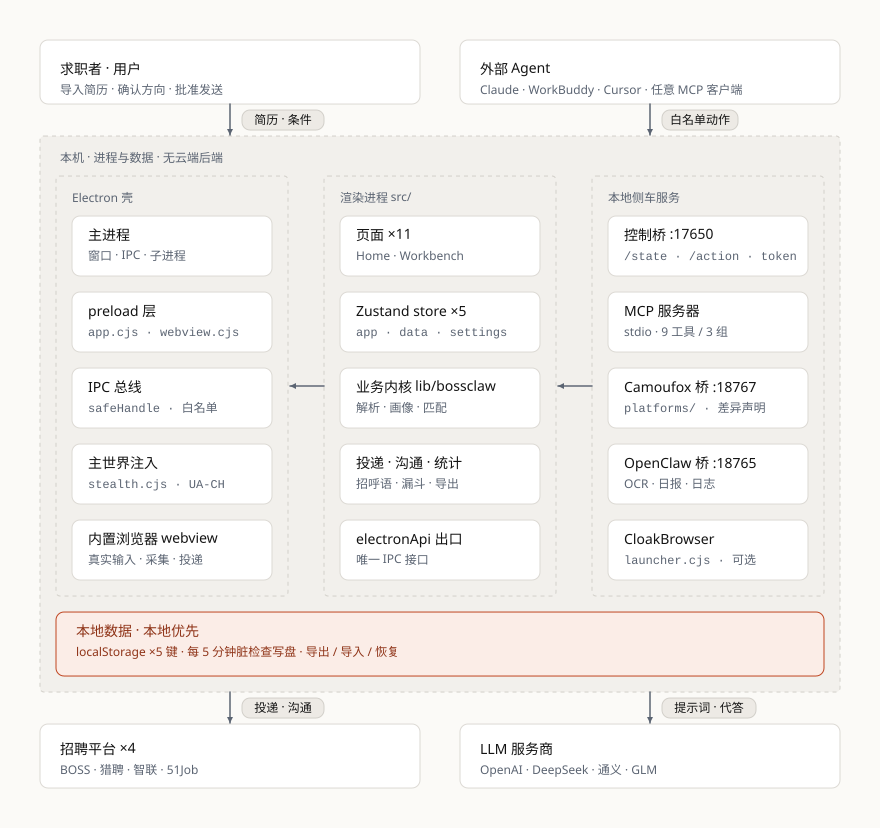

<div align="center">

# BossClaw

**面向求职者的本地 AI 投递助手（Electron 桌面应用）**

独立运行，不占用你的浏览器 —— 正常上网的同时，让简历整理、岗位筛选、匹配排序、沟通草稿和投递进度集中在同一个窗口里。

[这是什么](#这是什么) · [快速开始](#快速开始) · [使用流程](#使用流程) · [核心能力](#核心能力) · [能力规模](#当前能力规模) · [适合谁](#适合谁与不适合谁) · [架构](#架构与布局) · [安全边界](#安全与使用边界) · [桌面版说明](desktop-app/README.md) · [Wiki](https://github.com/YanQuan-dozzy/Boss-Claw/wiki) · [Agent 接入](#外部-agent-接入可选控制桥--mcp--代答)


<h3 align="center">⭐ 如果 BossClaw 对你有帮助，欢迎 <a href="https://github.com/YanQuan-dozzy/Boss-Claw">点个 Star</a> 支持作者，让更多需要的求职者看到它。</h3>

</div>

> 本文以 `main` 分支当前实现为准，**当前版本 v2.6.0**（2026-10-22 发布，产物覆盖 Windows / Linux / macOS 三系统），上一正式版 v2.5.7（2026-10-13）。本次改动要点见 [版本与更新](#版本与更新)；**新增的「模拟面试」尚未经过完整测试，属可自行试用状态**，详见该功能小节。

## 这是什么

求职过程中，用户通常需要反复查看岗位要求、判断匹配程度、整理沟通内容、记录投递状态并处理失败任务。BossClaw 把这些环节整理为一条清晰流程：

```text
导入简历 → AI 生成职业画像 → 自主选择投递方向 → 整理岗位信息
        → AI 匹配与优先级排序 → 人工确认 / 半自动辅助 → 查看进度与处理异常
```

系统始终以**求职者 / 应聘者**身份工作：职业画像、岗位判断和沟通内容必须基于用户简历与岗位页面中存在的真实信息，不应虚构经历、技能、学历、薪资、到岗时间或其他事实。AI 输出仅作为辅助建议，重要内容应由用户核对后使用；BossClaw 的目标是减少重复整理工作，**而不是替代用户作出求职决定**。

**为什么是桌面端**：不同于必须寄生在浏览器里的扩展或网页脚本，BossClaw 是独立应用 —— 投递、沟通与登录态都在应用自带的浏览器窗口里完成，你的 Chrome / Edge / Firefox 照常使用；切走页面或关掉标签都不影响后台投递；简历、画像、任务与 API Key 全部留在本机。

## 为什么做 BossClaw

不是"岗位不够多"，而是四件重复的事没人替你做：

- **岗位散在四个平台**：BOSS、猎聘、智联、前程无忧各看一遍 JD、HR 活跃度和发布时间，判断标准还不一致。
- **匹配靠肉眼**：一天几十条岗位，硬门槛（城市、薪资、学历）和软信号（团队、职责）混在一起看，容易漏也容易错。
- **投完就忘**：进度记在聊天记录和 Excel 里，失败了不知道卡在哪一步，重试容易重复打扰同一个 HR。
- **让通用 AI 代写**：招呼语容易套模板，甚至补上简历里没有的经历 —— 这类内容发出去比不发更糟。

BossClaw 的答案是把这四件事变成一条可审计的本地流程：**先建立事实边界，再决定投不投，最后由人确认发送。**

## 快速开始

### 1. 下载安装

打包产物发布在 [GitHub Releases](https://github.com/YanQuan-dozzy/Boss-Claw/releases/latest)，v2.6.0 同时提供 **Windows / Linux / macOS** 三个系统：

| 系统 | 形式 | 文件 | 说明 |
| --- | --- | --- | --- |
| 🪟 **Windows 10/11（x64）** | 安装版（推荐） | [BossClaw-2.6.0-x64.exe](https://github.com/YanQuan-dozzy/Boss-Claw/releases/latest/download/BossClaw-2.6.0-x64.exe) | 标准 NSIS 安装包，可自定义安装目录、创建桌面 / 开始菜单快捷方式 |
| 🪟 **Windows 10/11（x64）** | 便携版 | [BossClaw-2.6.0-portable.exe](https://github.com/YanQuan-dozzy/Boss-Claw/releases/latest/download/BossClaw-2.6.0-portable.exe) | 绿色单文件，无需安装、解压即用 |
| 🐧 **Linux（x86_64）** | AppImage | [BossClaw-2.6.0-x86_64.AppImage](https://github.com/YanQuan-dozzy/Boss-Claw/releases/latest/download/BossClaw-2.6.0-x86_64.AppImage) | 免安装，`chmod +x` 后直接运行，跨发行版通用 |
| 🐧 **Linux（amd64，deb 系）** | deb 包 | [BossClaw-2.6.0-amd64.deb](https://github.com/YanQuan-dozzy/Boss-Claw/releases/latest/download/BossClaw-2.6.0-amd64.deb) | Debian / Ubuntu / Linux Mint：`sudo dpkg -i` 安装 |
| 🍎 **macOS（Intel / Apple Silicon）** | 源码自构建档案 | [BossClaw-2.6.0-mac.tar.gz](https://github.com/YanQuan-dozzy/Boss-Claw/releases/latest/download/BossClaw-2.6.0-mac.tar.gz) | 解压后执行 `./build-mac.sh` 生成 dmg + zip（双架构） |

**各系统获取方式**

- **🪟 Windows**：直接下载上表 `.exe`，双击即用；安装版会创建快捷方式，便携版为单文件、可放任意目录。
- **🐧 Linux**：AppImage 给 `chmod +x BossClaw-2.6.0-x86_64.AppImage` 后双击 / 命令行运行；deb 执行 `sudo dpkg -i BossClaw-2.6.0-amd64.deb`（缺依赖时补 `sudo apt -f install`）。
- **🍎 macOS**：dmg / zip 受 electron-builder 限制**只能在 macOS 上构建**，官方只提供源码打包档案 —— 解压后执行 `./build-mac.sh`（自动装依赖 + 打包，支持 Intel / Apple Silicon），或在源码目录执行 `npm run package:mac`。

- **运行要求**：Windows 10/11（x64）；Linux 主流 x86_64 发行版；macOS 需在 macOS 上自构建后运行。
- 需要 rpm（RHEL / Fedora）/ pacman（Arch）等其它 Linux 格式时，自行向 `build.linux.target` 补充目标后重新打包。
- BossClaw 由用户主动控制，不属于任何招聘平台的官方产品，也不代表平台提供授权、合作或背书；使用者应遵守适用法律、目标网站规则及账号使用要求。

### 2. 首次配置

1. 「设置」页填写求职条件与 AI API Key（预设 OpenAI / DeepSeek / 通义千问 / 智谱 GLM / 硅基流动 / 火山方舟，或自定义 OpenAI 兼容端点）→ 测试连接并保存
2. 「简历中心」导入并核对简历原文 → 生成、检查并编辑职业画像（**删除任何不准确、无证据或夸大的内容**）
3. 「投递方向」勾选要投的方向并点「确认方向」（未确认不会建立任务）
4. 「工作台」打开岗位详情页 → 「加入任务」→ 中栏核对后批准 → 人工确认发送

> API Key 只存本机，不上传。未配置 Key 时，可改用外部 Agent 代答（见 [Agent 接入](#外部-agent-接入可选控制桥--mcp--代答)），或按 [从源码运行](#本地开发) 自行构建。

### 3. 首次执行只做一条验收

第一次使用半自动 / 自动辅助时，**只处理一个由自己确认的岗位**，逐项确认：打开的是所选岗位、沟通对象与岗位一致、沟通文字基于真实简历、页面出现完整的**已发送文字气泡**、任务状态记录正确、无登录异常或安全验证。

任何一步无法确认都应立即暂停并查看原因，不要连续重复执行 —— 系统在首次成功投递后也会**强制暂停**待你验收。

## 使用流程

| 节奏 | 发送方式 | 适合 |
| --- | --- | --- |
| **人工确认** | AI 完成岗位分析与沟通草稿后，由用户逐条检查、修改并决定是否继续 | 首次使用、对 AI 草稿还不放心 |
| **半自动投递** | 中栏批准岗位 → 浏览器跳转对应页 → AI 草稿预填沟通框 → **用户点发送** | 日常主力节奏 |
| **自动辅助** | 按匹配优先级依次投递 `approved_queue` 队列，失败自动暂停交人工核对 | 岗位量大、已建立信任 |
| **自动沟通** | 真实浏览器引擎按优先级依次打开沟通窗口并发送，发送结果确认后才计成功 | 需要批量触达，接受「确认后才算成功」的节奏 |

自动沟通模式下，BOSS 可另开「AI 跟聊监听」（冷却期或未登录时不可开启）。

> **多平台投递**：工作台「一键投递 / 开始投递」按岗位所属平台分派通道 —— BOSS 走内置浏览器详情页真实 DOM 沟通（开启「优先隐身通道」时改走 Camoufox）；猎聘 / 智联 / 前程无忧在各自平台的标签页内投递，外部网申 / 已投递岗位自动跳过；「自动沟通」引擎是另一条批量通道。
>
> **多平台采集**：引擎闸门只看是否启用隐身引擎 —— 开启走 Camoufox（列表 + 详情 JD + 词级断点续采），未开启走内置浏览器可视化采集（BOSS 详情级，其余平台列表级，详情 JD 按平台同源接口补齐），因此**未装 Camoufox 内核也能采集非 BOSS 平台**。各平台按优先级串行采集，遇队列级阻断即中止整批交人工。设置页的「基础求职条件」（求职类型 / 经验 / 学历 / 公司规模）在两条通道、四个平台上**一致生效**：内置浏览器通道拼进搜索 URL，隐身通道由 `camoufox/platforms/filters.py` 翻译成各平台参数（含 BOSS 的 `jobType / experience / degree / scale`）。

遇到安全验证、登录异常、对象不确定、页面结构异常或结果无法确认时，应立即暂停。进度与异常任务在「任务进度」页查看：任务级进度条 + 阶段标签（整理 / 匹配 / 排序 / 沟通 / 投递）与实时日志流，历史失败任务可打开原岗位后决定单条重试、忽略或继续。

## 核心能力

### 1. 首页与工作台

运行状态与配置进度概览。工作台为三栏布局（侧栏 + 消息进度 + 内置浏览器），承载「搜索采集 → 审核 → 投递」闭环，对应上面四种节奏。设置页支持导出 / 导入 / 清空本地数据与备份恢复；主题支持浅色 / 深色 / 跟随系统。

### 2. 多平台招聘（4 个）

BOSS 直聘为默认平台，**猎聘 / 智联招聘 / 前程无忧 51Job** 可选启用。设置页可调平台优先级（数字 1 = 最高，决定工作台搜索顺序与自动沟通的切换次序）、配置各平台每日配额（BOSS / 猎聘 / 前程无忧默认 120/日，智联 100/日），各平台登录态独立持久化，岗位卡片带平台标识。

四平台均已打通「搜索 URL 构造 → 列表采集 → 详情 JD 补齐 → 审核入队 → 投递」全链路。

> **一次采集能翻多少页**：两条采集通道的「加载更多」模型不同。
> **内置浏览器可视化采集不分页** —— BOSS 直聘是无限加载，滚动会持续追加岗位（「设置 → 搜索采集范围控制 → 自动下拉最大轮数」默认 12 轮，调大即可拿到远超首屏的量）；猎聘 / 智联 / 前程无忧是真分页，这条通道**只采第 1 页**。
> **Camoufox 隐身采集逐页翻** —— 设置 → 隐身引擎 → 「搜索结果页数」（每页约 30 条，默认 1 页，上限 10；服务端 `BOSCLAW_MAX_SEARCH_PAGES` 可调至 20），对「关键词 × 城市」逐页采集。
> 页数调大后，24 小时内采过的同一「平台 × 城市 × 关键词」会**重新采集**而不会被断点续采跳过（断点记录里带页数，只有「已采页数 ≥ 本次要求页数」才跳过）。

### 3. 简历中心

导入 PDF / DOCX / DOC（含旧版 Word 97-2003，以及「实为 RTF / HTML」的文件）/ MD / TXT，**全部本地解析**，并保留可编辑原文 —— 解析不在云端做，简历原文不出机器。

### 4. 职业画像与投递方向

AI 生成可编辑画像（失败逐级回落本地规则）；投递方向支持勾选、修改搜索词、调整优先级，以及 AI 生成 / 校准关键词。

### 5. 岗位过滤（确定性）

城市反选、公司 / 猎头黑名单、HR 活跃度、面试方式（**未明确披露不误杀**）、**JD 截止日期过期判定**（仅 JD 显式写明时生效，默认猎聘开启）。

这些判定**纯本地执行**，不消耗 AI Token，也不占用投递配额 —— 能被规则挡掉的岗位，不该花钱让模型看一遍。

### 6. AI 匹配与评分

**AI 四层整体裁决**：硬门槛 → 优先条件 → 职责信号 → 团队信号，一次判断给出 `fitLevel` 档位（`strong` / `match` / `cautious` / `unfit`）。

- **分数随档走、AI 分即最终分** —— 不做跨档加权融合，避免"硬门槛不过却因软信号得分高而排到前面"。
- 本地五维分只用于界面展示与 AI 不可用时兜底；唯一能改分的机制是**硬约束拦截**。

### 7. 沟通与投递

AI 生成个性化招呼语（求职者口吻、**≤250 字**）。工作台「一键投递」按岗位平台自动分派通道：BOSS 走详情页真实 DOM 沟通；猎聘 / 智联 / 前程无忧在各自平台标签页内投递。

### 8. 自动沟通与 AI 跟聊

可选真实浏览器引擎（Camoufox）实现多平台批量沟通，按平台优先级串行、各平台独立计数：

- **BOSS**：发送招呼语，以**文字气泡确认**为成功依据
- **猎聘**：「聊一聊」，走 App 预设招呼语
- **智联 / 前程无忧**：投递简历

**AI 跟聊（仅 BOSS，可选开关）**：常驻巡检「已投递」会话，HR 发来新消息即带多轮上下文生成回复并发送；HR 明确拒绝则收口该会话。回复类发送**不计入**单日投递上限。

### 9. 定制简历

输入目标岗位 JD，生成定制摘要 / 量化经历 / 求职信 / 技能缺口 / 优化建议。仅引用简历中的真实事实，不达标回退本地规则。

### 10. 模拟面试

用正在投的岗位 JD + 自己的简历练一场会当场被追问的面试。

> **状态**：v2.6.0 安装包**已包含**（Phase 1–4B），但**尚未经过完整测试** —— 属「可自行试用」状态，不保证稳定，也可能存在未预料的问题；遇到问题请提 [Issue](https://github.com/YanQuan-dozzy/Boss-Claw/issues)，并附上版本号与出错步骤。
>
> 该功能的部分优化与更新代码**暂不开源**，因此公开仓库中的实现与安装包内的实现可能不完全一致；能力口径仍以本文与包内实际表现为准。

- **出题与追问**：两段式（通用题 → 按简历与上一轮回答深挖）；**一题只问一个问题**、题干有字数控、由浅入深；追问由本地规则优先驱动，同题 ≤2 轮，每轮标注意图（澄清 / 核对 / 深挖 / 加压 / 迁移）——**加压与迁移只在「压力」难度出现**，标准难度下答得扎实就推进。
- **评分与报告**：结束后逐题 4+1 维四档评分 + **本地加权总分**与四档证据档，给出命中 / 漏答要点与改写建议 —— 数字必须能在原答或简历中找到。
- **雷达图与场次对比**：维度分画成雷达图，并自动叠加**同岗位上一场**的轮廓；总分与各维差值按「面试官类型 / 难度 / 评分口径是否一致」判可比性，条件不同会明说「仅供参考」，不给一个看起来精确的假差值。
- **报告导出**：单场可导出 Markdown（含维度表、逐题复盘、追问、反问、体征、总结），也能导出全部会话的 JSON 备份。
- **按缺口追练**：报告页可一键用本场的「最该补的缺口 + 偏弱维度」开一场同岗位追练，出题会围着这些缺口换场景问（不直接问缺口原文），评分口径不变所以能和上一场对比。
- **长期弱项**：同岗位近 4 场的漏答要点自动聚类（只收「至少两场都漏」的点），报告末尾列出「你总在漏什么」+ 长期维度均分，可一键按长期弱项追练。只读聚合，不是可编辑的错题本。
- **作答节奏**：报告给出总用时 / 平均每题 / 最长一题（本地记录，不进内容分）。
- **会话管理**：会话存主进程文件，支持断点续练、单题重答、导出。
- **语音朗读**：题干与追问本地朗读（Kokoro + sherpa-onnx，8 个精选音色，题干预渲染并缓存 WAV）；追问走**流式合成边出边播**，首块 1.7s 出声，而不是等整句 14s。设置 → 语音可一键安装语音包。
- **在线高音质档**（可选，**默认关闭**）：走 Edge 神经语音，开启前显式提示「题干文本会发到微软」，接口失败静默回落本地，只影响这一句。
- **导入音色包**：支持 Piper **转换版** / VITS、Kokoro 布局，先试听再复制入库，缺音素数据时自动借用内置包；原生 Piper 包与 Matcha / Kitten / Pocket 明确提示不支持。导入的 vits 音色合成比内置快约 7 倍（RTF 0.11，追问首包 204ms）。
- **本地面试题库 + BM25 召回**：内置 13.6K 题（可停用），支持 JSON / CSV / Markdown / docx 导入、去重、增删改；出题时召回 20 条候选，并在同一次 AI 调用里完成重排。
- **语音作答**：本地 SenseVoice，16k 录音 → 本机转写 → 可修改后提交。语速 / 长停顿 / 口头禅三项体征单独展示，**不计入内容分**。
- **克隆我的声音**：ZipVoice 零样本，3–10 秒参考音频即可，本地保存、不上传；克隆声只用于题干预生成，追问自动回落内置音色。
- **输入来源**：岗位 JD 可从工作台采集队列一键导入（按已投递 / 待投递排序，标注 JD 完整 / 仅摘要 / 无 JD），导入即把 JD 原文快照进本场会话 —— 工作台清缓存不影响已导入的会话。
- **限制**：未配置 API Key 时不可用（不接 agent 代答）。

> 该功能的完整设计文档与实现细节不随仓库分发；在线语音引擎与打包冒烟尚未完成，因此本版按「可试用、不保证稳定」发布。

### 11. AI 技能

标准 `SKILL.md` 技能体系，内置 9 项（含 `mock-interview-question` / `mock-interview-report`），支持自定义技能导入 / 新建 / 删除，按作用域注入提示词；设置页里自行导入 / 新建的技能（`userData/skills`）以及自行放进 `skills/` 目录的非出厂技能均可直接删除，出厂内置技能只提供开关停用。

### 12. 数据统计

投递量 / 沟通量 / 成功率看板，外加**投递漏斗**（采集入队 → 已投递 → 已打开沟通 → 已回复 → 面试）。支持导出岗位明细 CSV / 统计汇总 CSV / 统计报表 PDF（A4 横版）。

### 13. 定时任务、备份与自启动

按 `HH:mm` + 星期自动触发投递 / 采集 / 备份，可圈定目标平台与单轮上限。本地每 5 分钟做脏检查写盘，缺失时自动回签恢复；支持开机自启动。

### 14. 外部 Agent 接入

内置控制桥（白名单动作、本地令牌、默认关闭）+ 零依赖 MCP 服务器（9 工具 / 3 组）。未配置 API Key 时，可交由在线外部 Agent 代答 —— 详见 [Agent 接入](#外部-agent-接入可选控制桥--mcp--代答)。

### 15. 可选桥接与增强（默认关闭）

- **OpenClaw 本地 Node 桥接**：扫描版 PDF 的 OCR、求职日报、任务状态恢复与日志。
- **隐身引擎 Camoufox / 隐身浏览器 CloakBrowser**：设置页默认关闭，需主动启用，**不绕过**验证码与账户验证。

> 端口协议、目录结构、回归脚本与排障细节见 [`desktop-app/README.md`](desktop-app/README.md) 与 [Wiki](https://github.com/YanQuan-dozzy/Boss-Claw/wiki)。

## 当前能力规模

以下数字均可在当前代码与本文对应章节核对：

| 能力 | 当前规模 |
| --- | --- |
| 招聘平台 | 4 个（BOSS 直聘 / 猎聘 / 智联招聘 / 前程无忧） |
| 投递节奏 | 3 档人工控制（人工确认 / 半自动 / 自动辅助）+ 1 条批量通道（自动沟通） |
| 简历解析格式 | 5 种（PDF / DOCX / DOC / MD / TXT），全部本地执行 |
| 内置 AI 技能 | 9 项（`SKILL.md`） |
| 内置模拟面试题库 | 13.6K 题（可停用） |
| 每日投递配额 | BOSS / 猎聘 / 前程无忧 120，智联 100；上限受 `MAX_SAFE_DAILY=150` 收窄 |
| 定时任务动作 | 3 类（投递 / 采集 / 备份） |
| MCP 工具 | 9 个 / 3 组 |
| 侧栏入口 | 12 个 |
| 可选隐身引擎 | 2 种（Camoufox / CloakBrowser），默认关闭 |

## 适合谁与不适合谁

**适合：**

- 同时在 BOSS、猎聘、智联、前程无忧投递，靠表格或聊天记录管进度的人
- 想用自己 API Key 的模型做匹配与招呼语，但不愿把简历交给第三方 SaaS 的人
- 需要「AI 先整理、人再拍板」，而不是全托管黑盒的人
- 拿到面试后想按 JD 真实练一场、但不想被摄像头和数字人绑架的人
- 想用 Claude / WorkBuddy / Cursor 等外部 Agent 驱动本机工具的人

**不适合：**

- 期望「一键海投、全程不用确认」的 —— 发送类动作默认不开放，首次成功投递后**强制暂停验收**
- 需要移动端、网页版或跨设备同步的 —— 数据本地优先，存于 `localStorage`
- 想绕过验证码、账号限制或平台风控的 —— 明确不做，遇 code 32 / 35 / 36 / 37 立即停止交人工
- 既不配置 API Key、也不接外部 Agent 代答的 —— AI 相关能力不可用
- 需要 macOS 官方分发包的 —— dmg 需自行在 macOS 上构建

## 与其他方案的区别

| 方案 | 优势 | 常见限制 |
| --- | --- | --- |
| 浏览器扩展 / 网页脚本 | 免安装，贴着页面操作 | 寄生在常用浏览器里，切标签或关窗即断；登录态与日常上网混在一起 |
| 招聘平台自带「一键投递」 | 官方通道最稳 | 只覆盖本平台，没有跨平台匹配排序与沟通草稿 |
| 通用 AI 对话 | 生成文字快 | 不接触岗位页面与投递链路，JD 靠手抄，匹配判断无从核验 |
| 投递 SaaS / 代投服务 | 省事 | 简历与账号交由第三方，数据不在本机 |
| 以量取胜的自动化脚本 | 投递量大 | 常依赖反检测与账号轮换，账号风险高、过程不可审计 |
| **BossClaw** | 本地优先、四平台闭环、AI 裁决可解释、发送前必确认、终稿数据留本机 | 需自行安装与配置 API Key；发送环节需人确认；平台页面改版会影响采集与投递 |

## 架构与布局

<picture>
  <source media="(prefers-color-scheme: dark)" srcset="assets/architecture-dark.svg">
  
</picture>

- **技术栈**：Electron `^42`（Chromium 148）+ React 18 + TypeScript + Vite 5 + Ant Design 5 + Zustand（persist → localStorage），本地数据零后端依赖。
- **进程模型**：主进程（CommonJS）+ 预加载脚本（`contextBridge` 安全 IPC）+ React 渲染层；`contextIsolation: true`、`nodeIntegration: false`、`webviewTag: true`。
- **界面**：顶部标题栏 + 左侧 12 入口侧栏 + 底部状态栏；「工作台」为三栏，其余页面为双栏。
- **内置浏览器**：Electron `<webview>`，默认加载 BOSS 直聘，可切换各已启用平台首页；登录态按平台本地持久化（免重复登录）。
- **多平台口径**：平台差异集中在 `electron/preload/platform-adapters.cjs`（纯数据 + 纯函数）；BOSS 是唯一「列表内联详情」形态，非 BOSS 列表级采集的详情 JD 由内置浏览器按**平台同源**接口补齐（智联 = 详情 JSON、猎聘 = 同源 SSR 详情页 HTML，**与是否安装 Camoufox 无关**）。
- **故障隔离**：平台级故障（未登录 / 4xx·5xx）只收口当前平台、后续平台继续；队列级故障（风控码 32·35·36、环境异常 37·38、未知码 fail-safe）立即中止整批交人工。

## 外部 Agent 接入（可选）：控制桥 · MCP · 代答

BossClaw 自带一条面向外部 Agent 的本地控制通道，供 Claude / WorkBuddy / Cursor 等任意 MCP 客户端读取实时状态并驱动白名单动作。**默认关闭，必须显式开启**，无需任何云端服务。

| 组成 | 位置 / 端点 | 说明 |
| --- | --- | --- |
| 应用内控制桥 | `127.0.0.1:17650`（`electron/control-bridge.cjs`） | 仅监听本机回环；除 `/health` 外全部要求 `x-bossclaw-token`，令牌写入 `<userData>/control-bridge.json` |
| 开启方式 | `BOSSCLAW_CONTROL=1` 或 `--control-bridge` | 仓库根 `start-bossclaw.cmd` 启动默认开启（`--no-agent` 可关）；裸 `electron .` 与打包版默认关闭 |
| MCP 服务器 | `mcp/bossclaw-mcp`（零依赖 stdio） | **9 个工具 / 3 组**：运行控制（3）· 应用控制（2）· agent 代答（4） |

**动作边界（硬约束）**：动作由渲染层白名单（`src/lib/controlRuntime.ts`）强制，覆盖状态读取、切页、主题、暂停 / 恢复投递、平台与调度配置、数据写入、AI 生成、浏览器只读 + 白名单操作等。**发送 / 批量投递默认不开放**：仅当用户在应用内开启「全自动」（`executionMode === 'auto'`）后，`deliverySendNow`（及 MCP 代答组 `bossclaw_agent_send`）才可用；自动沟通引擎（`autochatStart` / `autochatStep`）另受冷却期、每日上限、招呼语非空等守卫约束。所有发送都**复用应用自带安全引擎**，且**不提供绕过验证码、绕过速率限制或修改 `SAFETY_LIMITS` 的能力**；`executionMode` / `apiKey` / `pausedUntil` / `platforms` 不可经控制桥改写。

**Agent 代答**：当用户**未配置 AI API Key** 时，应用内 AI 调用（岗位分析 / 职业画像 / 打招呼语 / 定制简历）会把「完整提示词 + 用途 + 是否要 JSON」挂进本地待答队列，由在线外部 Agent 用自有模型回答后回填：

```text
应用（无 apiKey）→ 入队等待
  → Agent：bossclaw_agent_tasks（长轮询领取，领取即心跳）→ 用自有模型生成
  → Agent：bossclaw_agent_submit 回填 → 应用按与真实模型调用相同口径解析并继续自身校验链
  （答不出可 bossclaw_agent_cancel，应用立刻回落本地规则）
```

- **在线判定 / 时限**：最近 90s 内调用过 `bossclaw_agent_tasks` 才算在线（应用无法主动调用 stdio MCP）；单任务等待 30s ~ 240s，超时即回落本地规则，JSON 纠偏最多 1 次。
- **只搬运「提示词 ↔ 生成文本」**：不涉及投递、发送、验证码、速率限制或安全参数；回填内容仍要过全部校验链（事实与口吻、校名披露、招呼语长度截断等），不合规照样被本地规则替换 —— 这是预期行为。
- 用户**配置了 API Key** 即直连自己的模型，不走代答。

## 安全与使用边界

BossClaw 官方版本不应实现、宣传或用于：

- 绕过验证码、登录验证、安全提示、访问限制或平台技术管理措施
- 导出、共享、出售或远程托管登录 Cookie、Token、Session 等会话凭证
- 未经授权调用内部接口、突破鉴权，或访问普通用户无权查看的数据
- 使用代理池、账号池、设备指纹伪装、账号轮换等反检测手段逃避限制
- 在账号受到限制后自动重新登录、自动换号或继续执行任务
- 多账号群控、骚扰式重复发送、虚假信息投递或极端高频操作
- 建立跨用户的招聘联系人 / 聊天记录 / 个人信息数据库，或伪造简历能力、经历、学历、薪资、到岗时间与面试安排
- 干扰网站正常运行，或将本项目用于违反适用法律和网站规则的行为

**出现以下任一情况应立即停止并由用户处理**：验证码 / 安全验证 / 账号异常；登录受限、访问受限或频率限制；当前岗位、公司或沟通对象无法确认；页面结构变化导致执行目标不明确；沟通内容或附件的发送结果无法确认；用户未明确选择当前岗位或未授权本次操作。

**关键安全不变量**（贯穿所有投递环节）：

- 未确认右侧聊天**文字气泡**时：不发送附件、不计成功、不跳下一岗位
- 目标 HR 或会话明确冲突时：不发送；**外部网申岗位**：跳过；同一任务重复重试会被锁定
- **首次成功投递一条后必须暂停验收**，让用户核对聊天对象、文字气泡与附件
- 不得替用户承诺薪资、到岗时间、面试时间或不存在的经历
- 所有提示词与招呼语必须使用求职者口吻，仅引用真实简历事实
- 外部 Agent 通道（控制桥 / MCP / agent 代答）默认**只读写提示词与生成文本**；仅当用户已在应用内开启「全自动」时发送类动作才开放，且一律复用应用自带安全引擎的安全不变量，agent 不得改动安全参数或代替用户确认

> **关于可选增强「隐身引擎 / 隐身浏览器」**：设置页默认关闭，需用户主动启用，且**仅使用 Camoufox 原生隐身内核**（本地 Chrome / Edge 因无法通过反爬识别不可复用），目的是降低「正常操作被误判为机器人（环境异常 code 37）」的概率。它**不绕过**验证码 / 账户验证（code 35/36/32 仍立即停止并交人工），不自动换号，不突破任何平台限制；涉及风控码、首次投递验收、招呼语非空等安全不变量与内置浏览器通道完全一致。

## 数据与隐私

- 简历、职业画像、筛选条件、API Key 和任务记录默认保存在**用户本机**（localStorage）；项目不要求导出、上传或共享登录 Cookie、Token 和会话文件；各平台登录态仅在本地持久化用于免重复登录，不上传。
- 不应持久化与求职任务无关的招聘联系人个人信息或完整聊天记录；AI 功能可能将必要的简历摘要与岗位信息发送给**用户自行配置**的模型服务商，请按自身隐私要求选择服务，并在不需要时删除本地数据。
- 请勿把真实简历、API Key、手机号、邮箱、身份证信息或完整运行日志提交到公开仓库和 Issue；导出诊断信息前应检查并隐藏个人身份、联系方式、聊天内容、账号信息与密钥。

## 项目结构

```
Boss-claw/
├── desktop-app/               当前主应用（Electron + React，v2.6.0）
│   ├── electron/              主进程 main.cjs + control-bridge.cjs + preload/（app / webview / platform-adapters）
│   ├── bridge/  camoufox/     OpenClaw Node 桥接后端 · Python 隐身引擎桥（camoufox_server.py + platforms/ 多平台采集层）
│   ├── skills/  src/          AI 技能库（SKILL.md 内置 9 项）· React 渲染进程（store / components / pages / lib）
│   └── resources/  package.json   应用图标与随包文档 · 依赖、scripts 与 electron-builder 打包目标
├── mcp/bossclaw-mcp/          可选：零依赖 stdio MCP 服务器（9 工具 / 3 组）
├── install-deps.cmd           一键安装依赖（Node + Electron，可选 Python 隐身引擎）
├── start-bossclaw.cmd         一键启动脚本（默认开启控制桥，`--dev` / `--visible` 可选）
├── ATTRIBUTION.md / NOTICE    署名与 Apache-2.0 通知
└── LICENSE                    Apache License 2.0
```

完整目录说明见 [`desktop-app/README.md`](desktop-app/README.md)。

## 本地开发

### 环境与依赖

需要 Node.js 20+（推荐 22）；隐身引擎需 Python 3.10+。仓库**不含**运行时依赖（`node_modules` / Electron 二进制 / Python 包均需自行下载）。

```bash
# 方式一（推荐，Windows）：双击仓库根目录的 install-deps.cmd（自动处理镜像与重试；
#   可选安装 Python 隐身引擎 camoufox + playwright）
# 方式二（手动）：
cd desktop-app
npm install           # 安装依赖（含 Electron 二进制）
npm run dev           # 启动 Vite dev server
npm run dev:electron  # 构建 renderer 并以 Electron 打开
```

> 国内网络：`npm install` 失败时加 `--registry=https://registry.npmmirror.com`；Electron 二进制下载失败时执行 `set ELECTRON_MIRROR=https://npmmirror.com/mirrors/electron/ && node node_modules/electron/install.js`。

也可以双击仓库根目录的 `start-bossclaw.cmd` 一键启动：默认走「快速路径」直接运行 `dist/` 产物（检测到源码改动会先重建），`--dev` 改用 Vite dev server，`--visible` 保留控制台日志，`--no-agent` 不开启本地控制桥。

### 常用命令

```bash
cd desktop-app
npm run dev             # Vite dev server（http://localhost:5173）
npm run build           # tsc 类型检查 + vite 构建到 dist/
npm run verify          # typecheck + build 组合
npm run package         # 打包 Windows 安装包（NSIS + 便携版，产出到 release/）
npm run package:linux   # 打包 Linux（AppImage + deb）
npm run package:mac     # 打包 macOS（dmg + zip，需在 macOS 上执行）
```

打包格式由 `desktop-app/package.json` 的 `build.*.target` 决定，需要 rpm / pacman 等其它格式时自行补充目标后重新打包。开发模式加载 `http://localhost:5173`，生产模式加载 `dist/index.html`。

涉及业务逻辑改动时，请优先回查 `desktop-app/` 下的既有实现与 [Wiki](https://github.com/YanQuan-dozzy/Boss-Claw/wiki) 文档，对齐既定口径，禁止凭空重写。

## 版本与更新

**当前版本 v2.6.0**（2026-10-22 发布）；上一正式版 v2.5.7（2026-10-13）。产物覆盖三个系统：**Windows 10/11 x64**（安装版 / 便携版）、**Linux x86_64**（AppImage / deb）、**macOS**（Intel / Apple Silicon 源码自构建档案），见 [下载安装](#1-下载安装)。

本条目的改动主轴是**新增「模拟面试」**——用正在投的岗位 JD + 自己的简历练题：两段式出题与动态追问、4+1 维四档评分、雷达图与同岗位场次对比、按缺口与长期弱项追练、本地语音朗读与语音作答、内置 13.6K 本地面试题库。

> ⚠️ **模拟面试尚未经过完整测试**：本版按「可自行试用」发布，不保证稳定，遇到问题请提 [Issue](https://github.com/YanQuan-dozzy/Boss-Claw/issues)。此外，该功能的部分优化与更新代码**暂不开源**，公开仓库与安装包内的实现可能不完全一致。

其余改动为文档层更新：README 信息架构重排（新增「适合谁 / 与其他方案的区别 / 当前能力规模」）、架构图（浅色 / 深色 SVG）、IPC 白名单口径同步（66 → 112）与技能数 / 侧栏入口数修正（9 项 / 12 个）；功能表按当前实现标注。

历史版本与产物见 [Releases](https://github.com/YanQuan-dozzy/Boss-Claw/releases)。

## 反馈与联系

遇到问题时，建议先查阅 [Wiki](https://github.com/YanQuan-dozzy/Boss-Claw/wiki) 与 [`desktop-app/README.md`](desktop-app/README.md) 的「常见问题」。提交 Issue 时请包含：BossClaw 版本（桌面版 v2.6.0）、操作系统与 Electron 版本、出错步骤、**已隐藏隐私信息**的截图、完整错误信息。

## 开源许可与署名

BossClaw 采用 [Apache License 2.0](LICENSE) 开源。复制、修改和再分发时，请保留 `LICENSE` 与 `NOTICE`，并清晰说明所作的实质性修改。详细署名要求见 [ATTRIBUTION.md](ATTRIBUTION.md)。

## 免责声明

BossClaw 是独立开发的开源求职辅助项目，与任何招聘网站、招聘服务商及其运营主体均不存在隶属、合作、代理、授权或背书关系。本项目仅提供本地简历整理、岗位信息分析、沟通草稿生成、任务记录及用户侧操作辅助能力；不保证第三方岗位信息的真实性、准确性、有效性或持续可用性，也不保证任何投递、沟通、面试或录用结果。

用户应当：仅操作本人有权使用的账号与数据；自行核实岗位、公司、联系人和沟通内容；遵守适用法律、网站服务协议、社区规则和账号使用要求；对是否启用自动辅助、是否发送内容及由此产生的账号和求职结果负责；在出现验证码、安全验证、账号限制或其他异常时立即停止使用相关自动化功能。

本 README 中的安全边界是官方版本的设计与维护原则，不构成对任何具体使用场景的法律意见，也不能替代用户对适用规则的独立判断。
